# Turniej Szachowy – dokumentacja

Aplikacja webowa do prowadzenia szkolnego turnieju szachowego: lista uczestników, losowanie par metodą Buergera, wpisywanie wyników i klasyfikacja. Powstała dla XII LO im. H. Sienkiewicza w Warszawie (nazwa szkoły jest wpisana na stałe w interfejsie).

## 1. Do czego to służy

Organizator dodaje uczestników w formacie `imie_klasa`, generuje pary na kolejną rundę i wpisuje wyniki partii. Aplikacja liczy punkty i pokazuje klasyfikację. Uczeń lub rodzic wchodzi jako gość, bez konta, i widzi pary, wyniki i klasyfikację tylko do odczytu.

Są trzy role: gość (tylko podgląd), nauczyciel (dodaje uczestników, generuje pary, wpisuje wyniki) i superadmin (dodatkowo usuwa uczestników, resetuje turniej i zakłada konta). Dane trzyma Supabase (Postgres z uprawnieniami na poziomie wierszy), a frontend działa w całości w przeglądarce.

## 2. Jak to wygląda

Zrzuty zrobiłem z kodu z gałęzi `main`, uruchomionego lokalnie na prawdziwym stosie Supabase (Postgres z `schema.sql` i `001_integrity.sql`, Supabase Auth, PostgREST z włączonym RLS), bez żadnej atrapy. Dane to osiem fikcyjnych osób, a konta demonstracyjne istniały tylko w tej lokalnej bazie. Uczestników, pary i wyniki wpisałem przez interfejs, tak jak zrobiłby to nauczyciel. Pominąłem zrzut wysyłki formularza kontaktowego i tworzenia konta (patrz „Ograniczenia”). Dwa symbole przy przyciskach backupu wyświetlają się jako puste ramki, bo przeglądarka bez interfejsu nie miała do nich glifów.

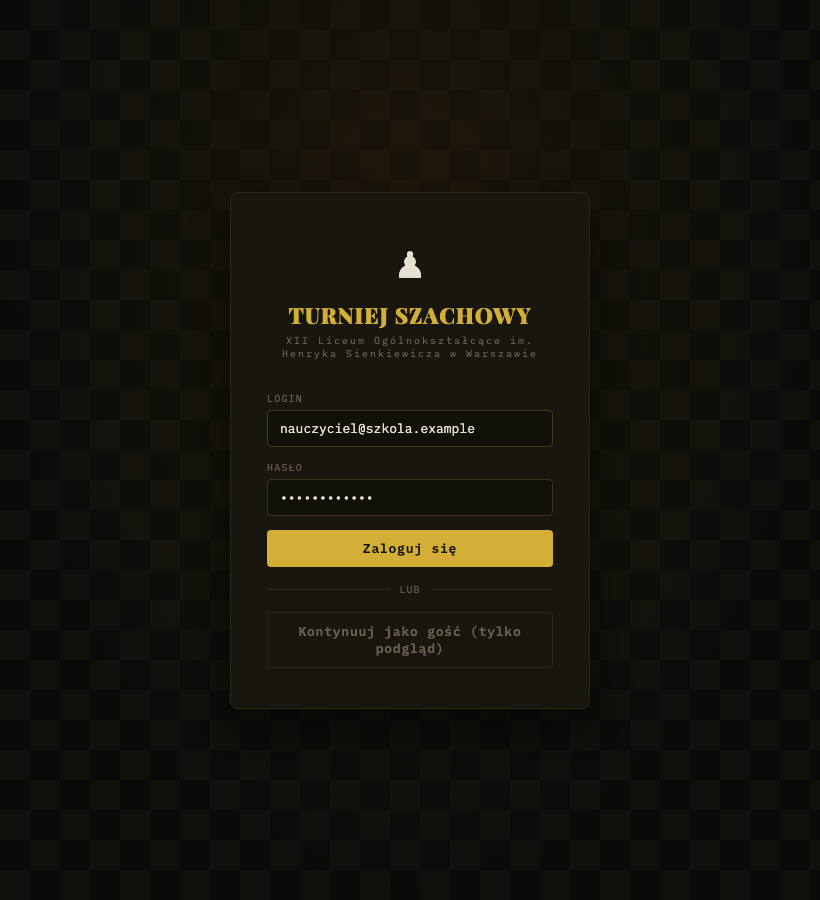

*Ekran logowania: login, hasło i przycisk wejścia jako gość.*

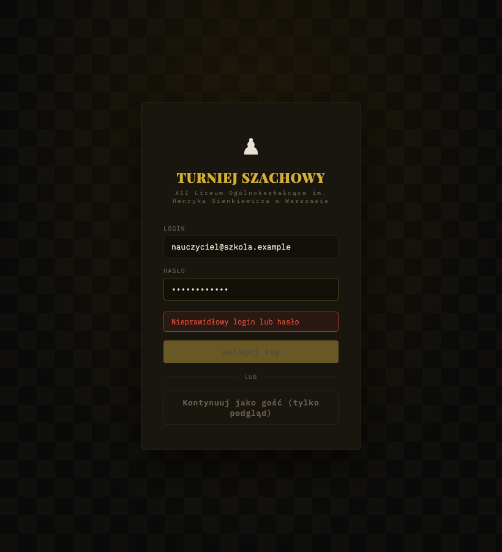

*Błędne hasło: odpowiedź Supabase Auth jest tłumaczona na „Nieprawidłowy login lub hasło”.*

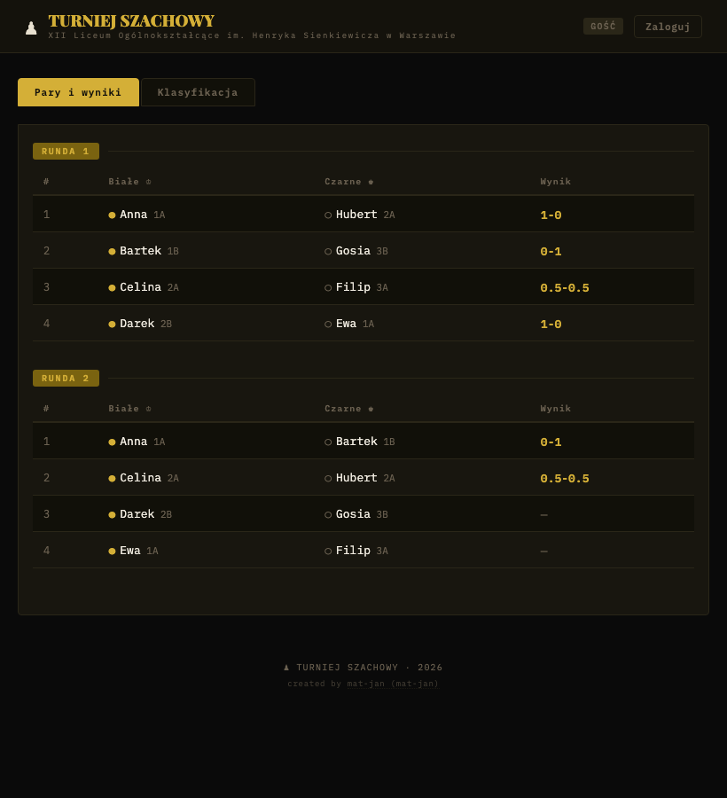

*Gość widzi pary rund 1 i 2 oraz wpisane wyniki, bez żadnych pól do edycji.*

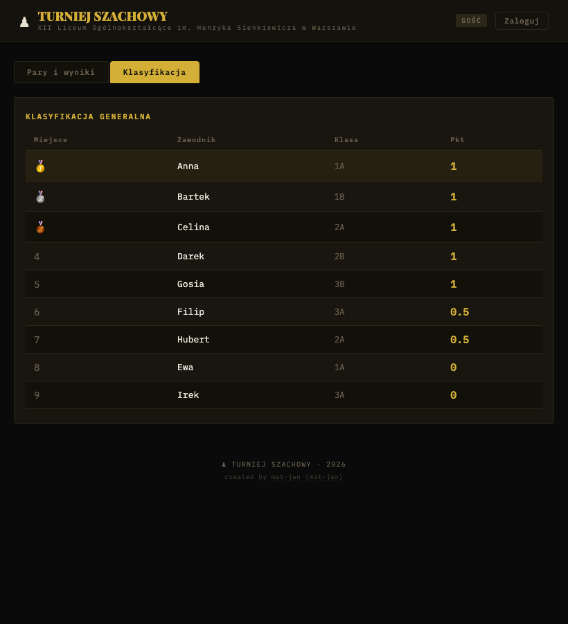

*Zakładka „Klasyfikacja”: miejsce, zawodnik, klasa i punkty.*

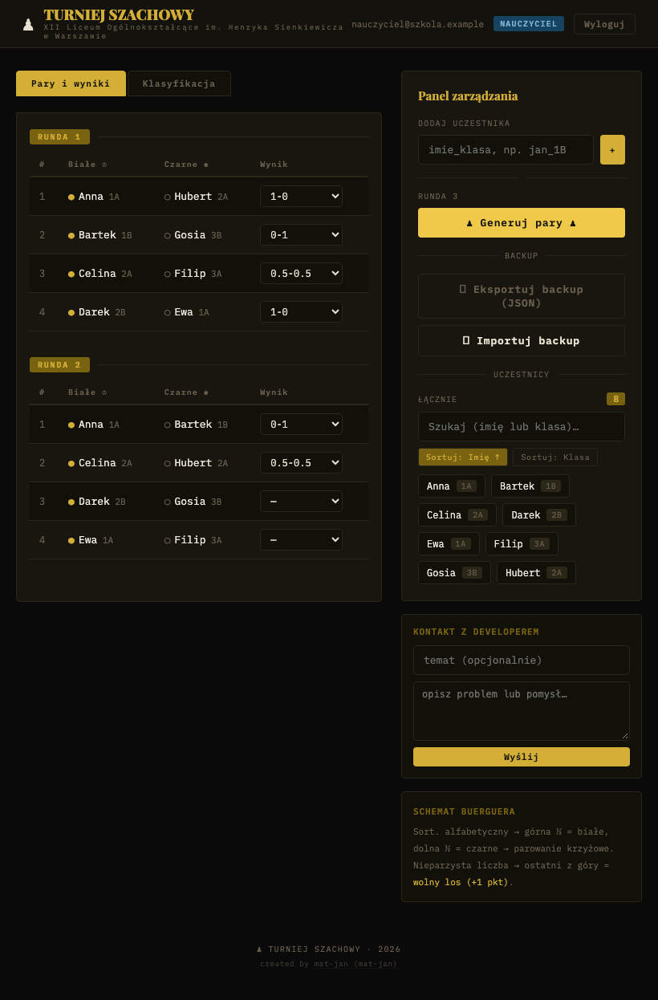

*Nauczyciel ma listy wyboru wyniku przy każdej parze oraz panel zarządzania po prawej.*

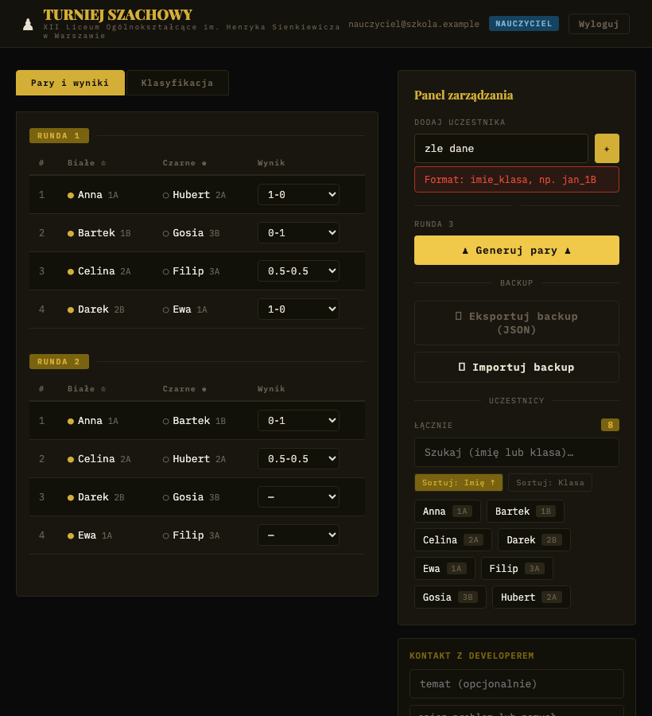

*Wpisanie „zle dane” w polu uczestnika kończy się komunikatem o wymaganym formacie.*

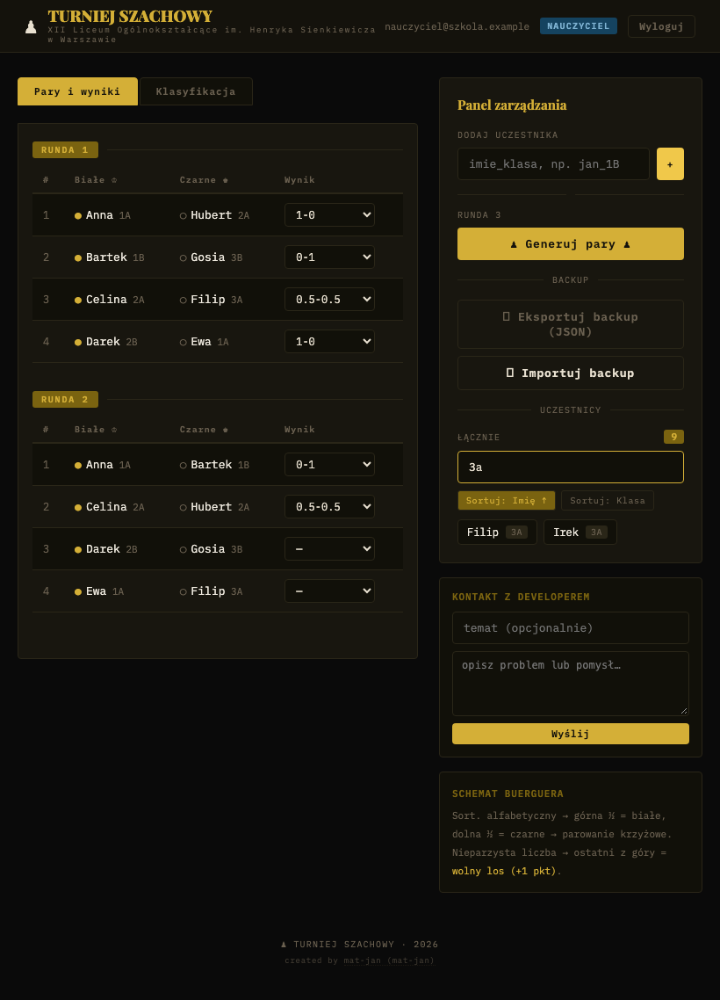

*Po wpisaniu „3a” na liście uczestników zostają tylko osoby z klasy 3A.*

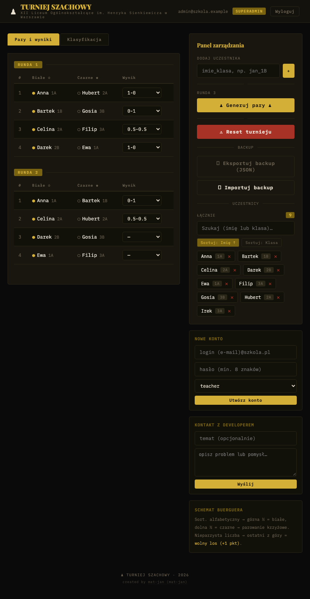

*Superadmin dodatkowo widzi przycisk resetu, krzyżyki przy uczestnikach i formularz nowego konta.*

Widok na telefonie (szerokość 390 px):

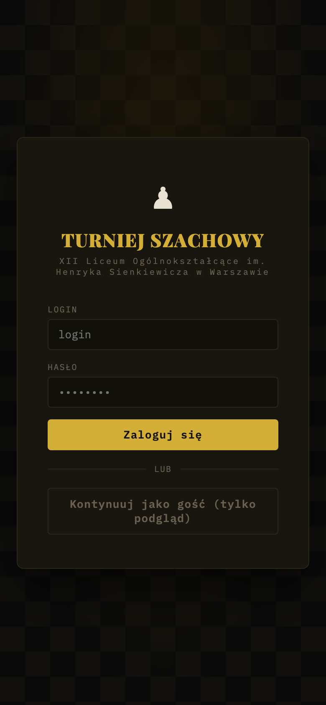 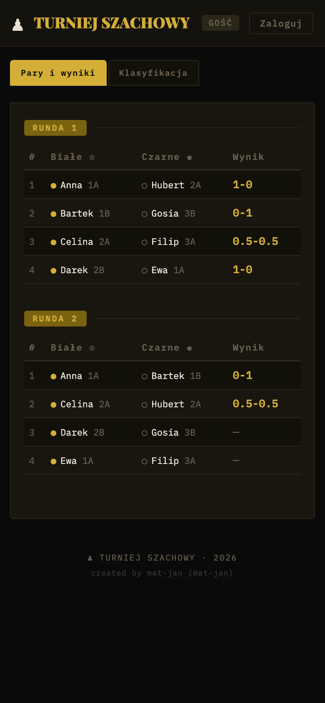

*Po lewej logowanie, po prawej widok gościa z parami.*

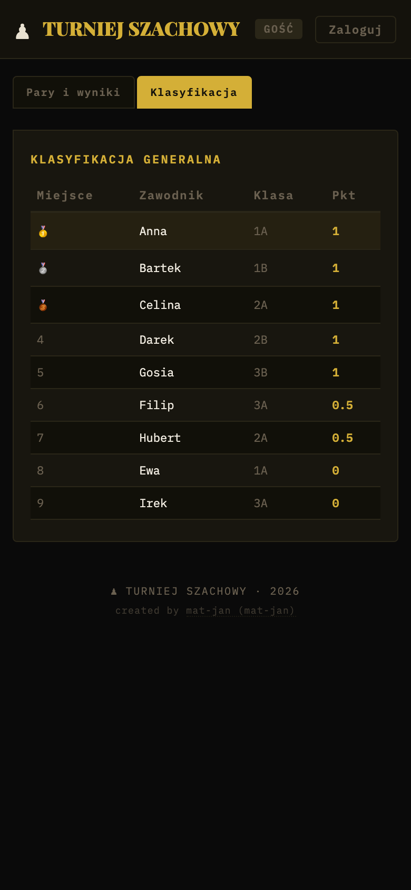 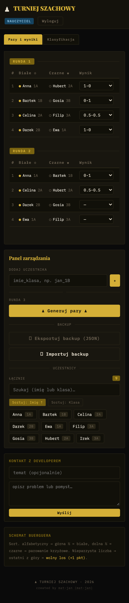

*Po lewej klasyfikacja, po prawej widok nauczyciela, w którym panel zarządzania leży pod tabelami.*

## 3. Jak z tego korzystać

### Gość

Na ekranie logowania kliknij „Kontynuuj jako gość”. Zakładka „Pary i wyniki” pokazuje rundy po kolei, zakładka „Klasyfikacja” ranking. Przycisk „Zaloguj” w nagłówku wraca do logowania.

### Nauczyciel i superadmin

Wpisz login (w praktyce adres e-mail konta) i hasło. Po zalogowaniu pojawia się panel zarządzania.

1. Dodaj uczestników w polu „Dodaj uczestnika”, w formacie `imie_klasa`, np. `jan_1B`. Klasa to część po ostatnim znaku `_`.
2. Gdy jest co najmniej dwóch uczestników, kliknij „Generuj pary”. Numer rundy to największy dotychczasowy numer plus jeden.
3. Wybierz wynik z listy przy każdej parze. Zapisuje się od razu po wybraniu.
4. Wyniki widać w zakładce „Klasyfikacja”.

Wyniki do wyboru: `1-0` (wygrały białe), `0-1` (wygrały czarne), `0.5-0.5` (remis), `wolny los` oraz puste. Wolny los daje 1 punkt, a remis po pół punktu każdemu.

Backup: „Eksportuj backup (JSON)” pobiera plik z uczestnikami i parami. „Importuj backup” dodaje zawartość pliku do istniejących danych, niczego nie kasuje, i przed importem pyta o potwierdzenie.

Lista uczestników ma szukajkę (po imieniu lub klasie) i sortowanie po imieniu albo klasie.

Tylko superadmin: usuwanie uczestników krzyżykiem, „Reset turnieju” (kasuje wszystkie pary i wszystkich uczestników, po potwierdzeniu) oraz „Nowe konto”.

| Formularz | Pole | Opis |
|---|---|---|
| Logowanie | Login | adres e-mail konta w Supabase Auth |
| Logowanie | Hasło | hasło konta |
| Dodaj uczestnika | imie_klasa | tekst w formacie `imie_klasa`, np. `jan_1B` |
| Nowe konto | login (e-mail) | adres e-mail nowego konta |
| Nowe konto | hasło | co najmniej 8 znaków |
| Nowe konto | rola | `teacher` lub `superadmin` |
| Kontakt z developerem | temat | opcjonalny, obcinany do 100 znaków |
| Kontakt z developerem | wiadomość | wymagana, do 1500 znaków (limit w polu) |

Formularz „Kontakt z developerem” widzą nauczyciele i superadmini. Wysyła wiadomość na webhook Discorda skonfigurowany przy wdrożeniu. W aplikacji jest odstęp 30 sekund między wiadomościami.

## 4. Jak to jest zbudowane

```
Przeglądarka (React + Vite)
   |-- odczyt/zapis tabel ----------> Supabase (PostgREST + RLS)
   |-- logowanie -------------------> Supabase Auth
   |-- tworzenie kont --------------> Edge Function create-user (service_role)
   |-- kontakt ---------------------> webhook Discorda
```

| Warstwa | Technologia |
|---|---|
| Frontend | React 18, Vite 5, jeden plik `App.jsx` ze stylami w kodzie |
| Dane i logowanie | Supabase (Postgres, Auth, Row Level Security), klient `@supabase/supabase-js` |
| Tworzenie kont | Edge Function `create-user` (Deno, TypeScript) |
| Parowanie | `pairing.js`, czyste funkcje bez zależności |
| Testy | Vitest |
| Hosting | Vercel (według README) |

Logika parowania i liczenia punktów jest w `app/frontend/pairing.js`, formularz kontaktowy w `contact.js`, schemat bazy w `app/supabase/schema.sql`.

Model danych:

| Tabela | Kolumny | Uwagi |
|---|---|---|
| `profiles` | `id` (uuid, klucz do `auth.users`), `email`, `role`, `created_at` | `role` to `teacher` albo `superadmin` |
| `participants` | `id`, `imie` (do 100 znaków), `klasa` (do 20), `created_at` | |
| `pairs` | `id`, `round_number`, `white_id`, `black_id` (może być pusty), `result`, `created_at` | klucze obce do `participants` z kasowaniem kaskadowym |

Parowanie działa tak: uczestnicy sortowani alfabetycznie, pierwszy zostaje na miejscu, reszta obraca się o numer rundy minus jeden. Górna połowa dostaje białe, dolna czarne. Przy nieparzystej liczbie uczestników jedna osoba dostaje wolny los.

## 5. Bezpieczeństwo

Poniżej tylko to, co wynika z kodu i skryptów SQL w repozytorium. Zachowanie polityk RLS i ograniczeń sprawdziłem zapytaniami do lokalnej bazy Supabase z tym samym schematem (patrz sekcja 7). Produkcyjnej bazy nie dotykałem.

| Zagrożenie | Zabezpieczenie |
|---|---|
| Gość zapisuje lub zmienia dane | Włączone RLS. Zapis do `participants` i `pairs` wymaga roli `teacher` lub `superadmin` w tabeli `profiles`. Rola jest sprawdzana w bazie, nie w przeglądarce. |
| Nauczyciel usuwa dane | Kasowanie uczestników i par dozwolone w polityce tylko dla `superadmin`. |
| Nauczyciel zmienia sobie rolę | Brak polityk insert/update/delete na `profiles` dla klienta. Konta zakłada wyłącznie Edge Function. |
| Obcy zakłada konta | Edge Function sprawdza token wywołującego i jego rolę (musi być `superadmin`), wymaga hasła co najmniej 8 znaków i usuwa konto Auth, jeśli zapis profilu się nie uda. |
| Klucz `service_role` w przeglądarce | Występuje tylko w Edge Function, pobierany ze zmiennych środowiska Supabase. We froncie jest wyłącznie klucz `anon`. |
| Duplikaty par i niepoprawne wyniki | Opcjonalna migracja `001_integrity.sql` dodaje indeksy unikalne i ograniczenia na wynik. Trzeba ją uruchomić ręcznie. |
| Wstrzyknięcie znaczników w treść | React domyślnie escapuje wyświetlane teksty. W kodzie nie ma `dangerouslySetInnerHTML`. |
| Pingi z formularza kontaktowego | Ładunek dla Discorda ma `allowed_mentions: { parse: [] }`, a długości pól są obcinane. |
| Sekrety w repozytorium | `.env` jest w `.gitignore`. W repozytorium jest tylko `.env.example` z przykładowymi wartościami. |

Zależności produkcyjne: `npm audit --omit=dev` nie znalazł podatności. Pełny `npm audit` zgłasza 6 podatności (3 umiarkowane, 1 wysoka, 2 krytyczne) w łańcuchu narzędzi testowych (Vitest, między innymi `tinypool`). Nie trafiają one do zbudowanej aplikacji.

## 6. Środowiska i wdrożenie

Produkcyjnie aplikacja (gałąź `main`) stoi na Vercelu i Supabase z katalogiem głównym `app/frontend`. Potrzebne zmienne: `VITE_SUPABASE_URL` i `VITE_SUPABASE_ANON_KEY` (wbudowywane w czasie budowania, po zmianie trzeba przebudować) oraz opcjonalnie `DISCORD_WEBHOOK_URL`.

Kroki konfiguracji bazy opisuje README: uruchomić `schema.sql` w SQL Editorze Supabase, ręcznie założyć pierwszego superadmina (użytkownik w Auth plus wiersz w `profiles`), wdrożyć funkcję `supabase functions deploy create-user`, opcjonalnie uruchomić `001_integrity.sql`.

Lokalnie:

```bash
cd app/frontend
cp .env.example .env   # uzupełnij danymi z Supabase
npm ci && npm run dev
npm test && npm run build
```

Wariant z własnym backendem FastAPI i PostgreSQL na VPS jest w osobnej gałęzi `vps`. Ta dokumentacja go nie opisuje.

## 7. Testy

Uruchomiłem `npx vitest run` w katalogu `app/frontend`. Wynik: 2 pliki, 9 testów, wszystkie zaliczone, czas około 0,2 s. Zrzuty ekranu powstały w osobnym skrypcie i nie są testami.

| Rodzaj | Plik | Liczba testów | Wynik |
|---|---|---|---|
| Jednostkowe: parowanie i punkty | `pairing.test.js` | 5 | zaliczone |
| Jednostkowe: wiadomość kontaktowa | `contact.test.js` | 4 | zaliczone |
| Interfejs (komponenty, przeglądarka) | brak | 0 | nie ma w projekcie |
| Reguły RLS na bazie | brak | 0 | nie ma w projekcie |
| Edge Function | brak | 0 | nie ma w projekcie |

Zbudowanie aplikacji (`vite build`) przeszło bez błędów.

Osobno sprawdziłem ręcznie, zapytaniami HTTP do lokalnego Supabase (konta demonstracyjne `teacher` i `superadmin`), jak zachowuje się baza. To nie są testy automatyczne w repozytorium.

| Próba | Wynik |
|---|---|
| Gość dodaje uczestnika | odrzucone (401) |
| Nauczyciel dodaje uczestnika | przyjęte (201) |
| Nauczyciel kasuje uczestników | nic nie usunięto (0 wierszy) |
| Nauczyciel zmienia sobie rolę na superadmin | nic nie zmieniono (0 wierszy) |
| Gość czyta `profiles` | pusta lista |
| Nauczyciel czyta `profiles` | widzi tylko własny wiersz |
| Gość czyta `participants` | dane widoczne |
| Para z wynikiem `xyz` (po migracji `001_integrity.sql`) | odrzucona przez ograniczenie `pairs_result_valid` |
| Logowanie w interfejsie, dodanie 8 uczestników, dwie rundy, wpisanie wyników | działa, wyniki zapisane w bazie |

## 8. Ograniczenia i dalszy rozwój

- Edge Function `create-user` nie została uruchomiona. Lokalnemu środowisku Docker zabrakło miejsca na obraz edge-runtime, więc tworzenie kont i jego zabezpieczenia znam tylko z czytania kodu.
- Sprawdzałem lokalną kopię Supabase (ten sam schemat i migracje), a nie produkcyjny projekt na Vercelu i Supabase. Ustawienia produkcyjne (np. czy migracja `001_integrity.sql` jest tam wgrana, konfiguracja Auth) mogą się różnić.
- Nie testowałem na prawdziwym telefonie, tylko w oknie przeglądarki o szerokości 390 px. Formularz kontaktowy nie był uruchamiany, bo lokalnie nie ma webhooka.
- Adres webhooka Discorda trafia do kodu strony (zmienna jest wystawiona przez Vite), więc każdy, kto otworzy stronę, może go odczytać i wysyłać na niego wiadomości. Ukrycie formularza dla gości tego nie zmienia. Odstęp 30 s jest sprawdzany tylko w przeglądarce. W razie nadużyć trzeba wygenerować webhook od nowa.
- Migracja `001_integrity.sql` jest opcjonalna. Bez niej baza nie blokuje duplikatów par ani niepoprawnych wartości wyniku, a numer rundy liczy przeglądarka, więc dwóch nauczycieli generujących pary jednocześnie może dostać zdublowaną rundę.
- Tryb gościa działa tylko w przeglądarce, ale dane i tak są publiczne: polityki `select` pozwalają czytać uczestników i pary każdemu, kto ma klucz `anon`.
- Metoda parowania to schemat Buergera (każdy z każdym). Kolejne rundy po pełnym obiegu zaczynają się powtarzać, a aplikacja tego nie blokuje.
- Brak testów interfejsu, testów RLS i testów Edge Function.
- Import backupu wstawia rekordy po jednym, więc przy dużych plikach trwa i może zostać przerwany w połowie.
- Nazwa szkoły jest wpisana w kodzie, a interfejs jest tylko po polsku.
